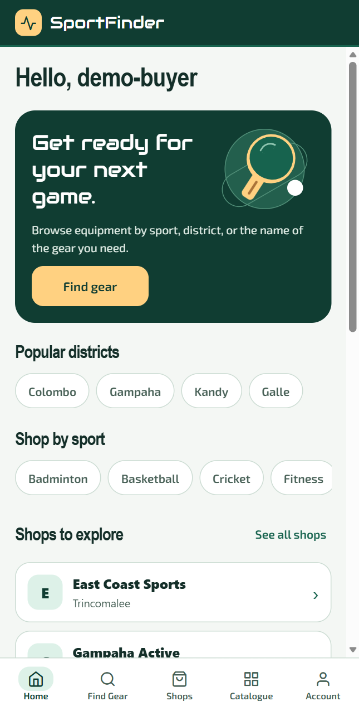
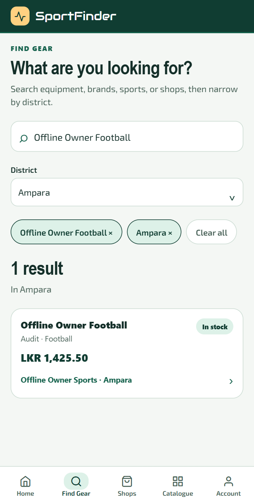
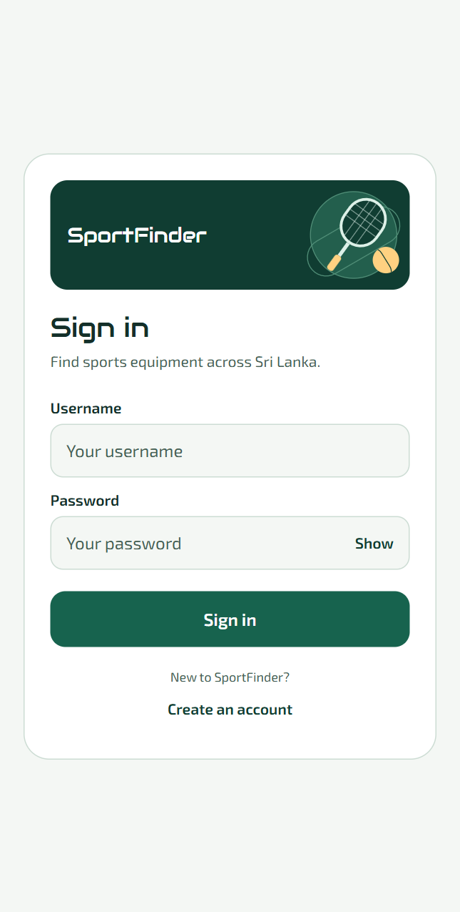
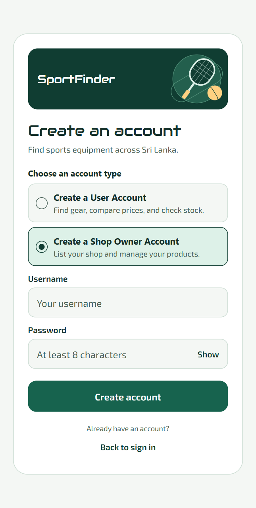
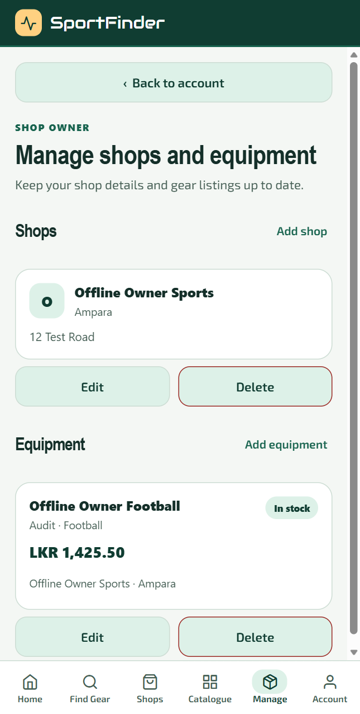
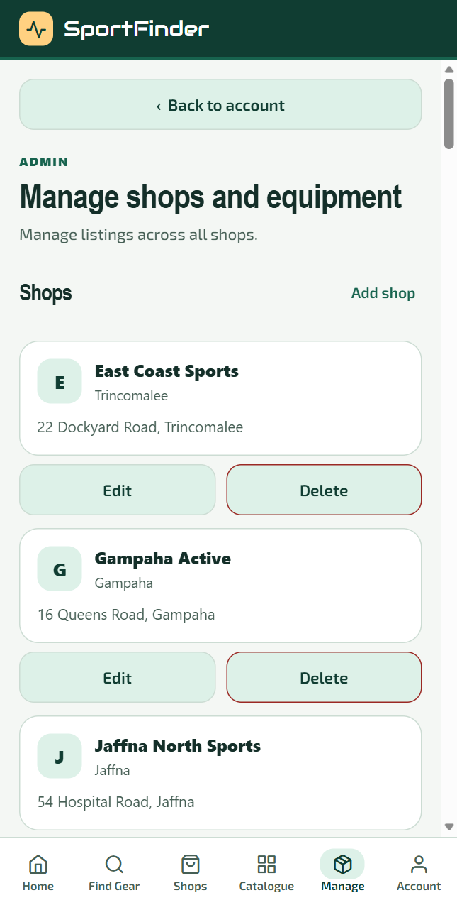
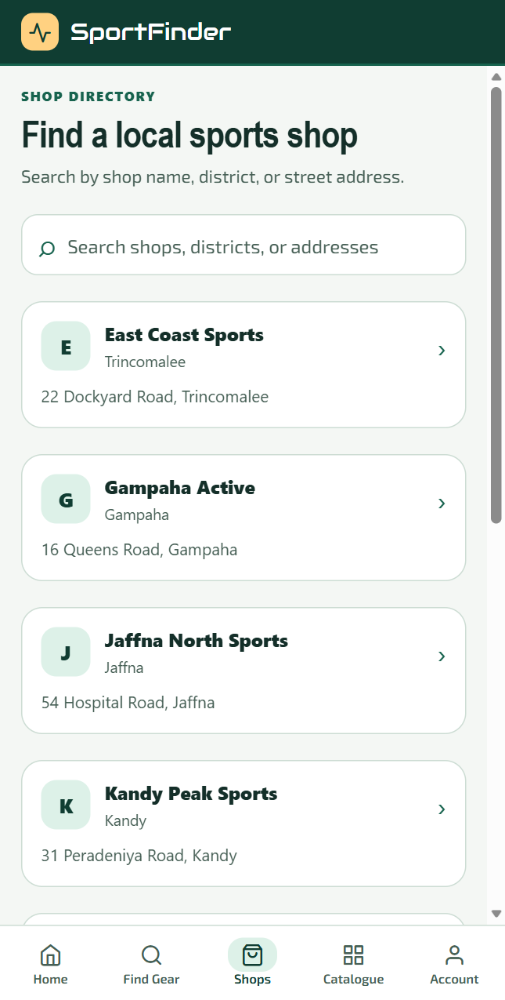
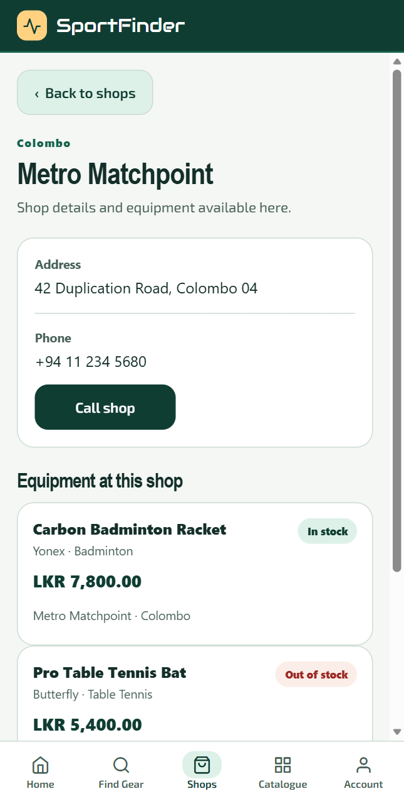
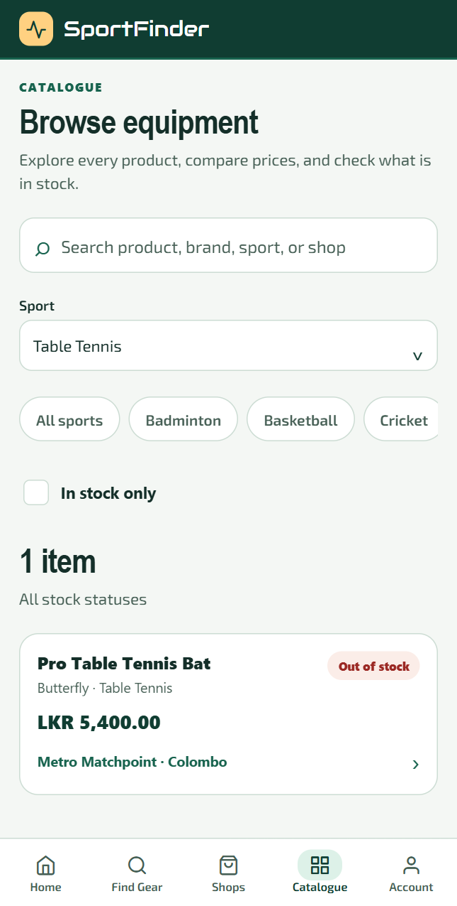
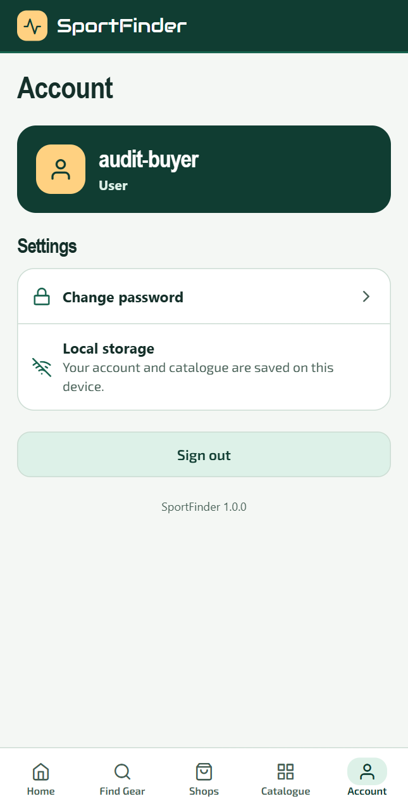

# SportFinder Mobile

SportFinder helps buyers find sports equipment in Sri Lanka by district, sport, brand, or shop. Buyers can check prices and availability before visiting a shop, while shop owners can maintain their listings on the same installation. The app uses a local SQLite database so searching, signing in, and managing inventory work without internet access in an installed release.

This is the **Sports UI** edition on `feature/sports-ui`. It adds a branded header, icon tabs, and an Account screen with offline password changes. The previous interface is available on [main](https://github.com/thisuri-a11y/SportsFinder_Mobile/tree/main).

## Key features

- **Find gear:** Search by product, brand, sport, or shop and filter by district. The catalogue can show in-stock items only.
- **Shop directory:** View each shop's address, phone number, and equipment. On a supported phone, the call button opens the dialer.
- **Inventory management:** Add, edit, and delete shops and equipment. Listings show prices in Sri Lankan rupees (LKR) and stock availability. Saved changes appear in the local catalogue.
- **Local accounts:** Buyers and shop owners can register in the app. Admins use the same sign-in form with an existing account. Open **Account** to see your role, change your password, or sign out. Shop owners and admins can also open **Manage** from Account.

| Role | Access |
| --- | --- |
| Buyer | Browse and search all shops and equipment on the installation. |
| Shop owner | Browse the catalogue and add, edit, or delete their own shops and equipment. |
| Admin | Browse the catalogue and manage listings across all shops. |

## Screenshots

Captured from the running web app at a phone-sized viewport using demo data.

| Home | Find Gear |
| --- | --- |
|  |  |

| Sign in | Create an account |
| --- | --- |
|  |  |

| Shop owner management | Admin management |
| --- | --- |
|  |  |

| Shop directory | Shop details |
| --- | --- |
|  |  |

| Table Tennis catalogue | Account settings |
| --- | --- |
|  |  |

## Technologies used

| Technology | Purpose |
| --- | --- |
| JavaScript and JSX, React 19, React Native 0.88 | App logic and screens |
| Expo SDK 58 and Expo Router | Android, iOS, and web builds and navigation |
| SQLite via `expo-sqlite` | Local catalogue, accounts, sessions, and database migrations |
| `expo-crypto` and `@noble/hashes` | Password salts and scrypt password hashing |
| Exo 2 and Audiowide via `expo-font` | Offline fonts for everyday controls and selected display titles |
| Node.js, npm, and ESLint | Local web preview, database tests, dependencies, and linting |

## Project structure

```text
SportsFinder_Mobile/
├── assets/                 App icons, splash screen artwork, and offline fonts
├── docs/screenshots/       Screenshots used in this README
├── scripts/serve-web.cjs   Local server for the exported web app
├── src/
│   ├── app/                Expo Router screens and layouts
│   │   ├── login.jsx       Sign-in and account registration
│   │   └── (tabs)/         Home, gear search, shops, catalogue, account, and management
│   ├── auth/               Accounts, password checks, and local sessions
│   ├── components/         Shared UI and theme
│   ├── db/                 SQLite setup, migrations, queries, and permissions
│   ├── hooks/              Query loading and refresh after changes
│   └── utils/              Shop and product form validation
├── tests/database.test.mjs SQLite integration tests
├── app.json                Expo configuration
└── package.json            Dependencies and npm commands
```

## Installation and setup

Use Node.js 24.3 or newer within the Node 24 release line, with npm. For the web preview, use a recent desktop browser such as Edge or Chrome. Native builds require the Android SDK or macOS with Xcode.

1. Clone the repository and install the locked dependencies:

   ```sh
   git clone --branch feature/sports-ui https://github.com/thisuri-a11y/SportsFinder_Mobile.git
   cd SportsFinder_Mobile
   npm ci
   ```

2. Build and serve the web preview:

   ```sh
   npm run web:preview
   ```

3. Open `http://localhost:8083` and sign in with a demo account, or choose **Create an account** and select **Create a User Account** or **Create a Shop Owner Account**. The preview opens its SQLite database in one tab at a time.

### Demo accounts

On a fresh installation, all three demo accounts use the password `SportFinderDemo1!`.

| Username | What to try |
| --- | --- |
| `demo-buyer` | Search for gear and view a shop's inventory. |
| `demo-owner` | Open **Manage** to see the seeded Lion City Sports shop and its equipment. |
| `demo-admin` | Open **Manage** to see and edit listings across all shops. |

### Native builds and checks

For development, run `npm start` to start Expo's development server. To install and run a release with the JavaScript bundle included, connect an Android device or start an emulator, or use macOS with Xcode for iOS. Run the command for your platform:

```sh
npx expo run:android --variant release --no-bundler
npx expo run:ios --configuration Release --no-bundler
```

Run `npm run lint` and `npm test` to check the source and exercise SQLite migrations, role permissions, ownership, catalogue filtering, and persistence.

## Browser storage recovery

If another SportFinder tab is using the database, close that tab and select **Retry**. If startup still fails, select **Reload page** to restart SQLite. Keep the same browser profile and preview address to access your saved accounts and listings.

## Offline storage and upgrades

The app creates `sportfinder.db` when it first runs. The seed includes Sri Lankan districts, sample shops and equipment, and demo accounts. SQLite stores price values as integer LKR cents, account passwords as salted scrypt hashes, and the current sign-in session. New listings and edits are saved on that installation. There is no server or cross-device sync, so a buyer sees an owner's changes when using the same installation.

The version 4 migration converts existing browsing accounts to buyers and preserves account IDs, passwords, sessions, and inventory. An existing admin stays in place. Deleting a shop also removes its equipment listings.

To check offline behavior on a phone, install a release build, turn on airplane mode, and open the app with Metro stopped. Sign in, search for gear, and save a listing as an owner or admin. Close and reopen the app to check that the session and listing persist. Placing a call still requires phone service.
